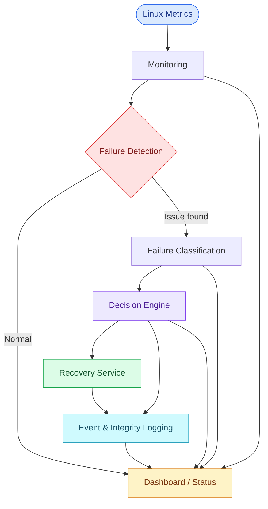

<div align="center">

# Decision-Driven Autonomous Self-Healing Cloud Infrastructure
### Blockchain-Based Trust and Recovery Management


<p>
  <strong>An educational prototype for monitoring system health, detecting resource problems, selecting recovery actions, and recording events.</strong>
</p>

<p>
  
  
  
  
</p>

<p>
  <a href="#-overview">Overview</a> •
  <a href="#-features">Features</a> •
  <a href="#-architecture">Architecture</a> •
  <a href="#-run-locally">Run Locally</a> •
  <a href="#-testing-and-safety">Testing & Safety</a>
</p>

</div>

---

## Overview

**Decision-Driven Autonomous Self-Healing Cloud Infrastructure with Blockchain-Based Trust and Recovery Management** demonstrates a workflow for detecting common system resource problems and responding with predefined recovery actions.

**In simple terms:** monitor the system, detect a problem, choose a response, attempt recovery, and record what happened.

## Features

<table>
<tr>
<td width="50%" valign="top">

### 

Live CPU, RAM, and disk metrics with a resource-history chart.

### 

Rule-based detection of supported overload conditions.

### 

A decision engine maps classified issues to configured actions.

</td>
<td width="50%" valign="top">

### 

Demonstrates recovery for supported CPU, memory, and disk scenarios.

### 

Incident and recovery records, with blockchain-inspired integrity logging.

### 

System status, decisions, processes, logs, and trust-related information in one interface.

</td>
</tr>
</table>

## Architecture



<details>
<summary><strong>How the workflow operates</strong></summary>

1. **Monitor** system resource usage.
2. **Detect** threshold-based anomalies.
3. **Classify** the issue, such as CPU overload, memory overload, or disk pressure.
4. **Decide** which configured response fits the detected condition.
5. **Recover** by running the corresponding action, where supported.
6. **Record** events and display information in the dashboard.

</details>

## Technology Stack

| Component | Technology |
|---|---|
| Backend | Java, Spring Boot |
| Build | Maven |
| Environment | Linux / Ubuntu |
| Frontend | HTML, CSS, JavaScript |
| Charts | Chart.js |
| Integration | REST API |
| Integrity approach | Blockchain-inspired event / hash-chain logging |

## Run Locally

**Prerequisites:** Java 21 (or the version configured in the project), Maven, Git, and Linux/Ubuntu for OS-level monitoring and recovery.

**1. Clone your repository** — replace the placeholders with your GitHub username and repository name.

```bash
git clone https://github.com/DevForgeCore/Self-Healing-Cloud-Infrastructure.git
cd Self-Healing-Cloud-Infrastructure
```

**2. Build and start**

```bash
mvn clean package
mvn spring-boot:run
```

Or run the packaged JAR:

```bash
java -jar target/*.jar
```

**3. Open the dashboard**

```text
http://localhost:8080
```

Check `application.properties` or `application.yml` if your app uses another port.

## Dashboard Preview

Add a screenshot of your actual dashboard to `docs/images/dashboard.png`, then remove the comment markers below to display it:

<!--
<p align="center">
  
</p>
-->

## API Endpoints

The dashboard integration may use these routes; confirm them against the current controller code:

| Endpoint | Purpose |
|---|---|
| `/api/system-health` | Current resource metrics and status |
| `/api/logs` | Application or recovery logs |
| `/api/processes` | Process information |

## Testing & Safety

Use a **disposable test VM**, not a production machine. Stress tests can make a system unstable.

| Test | Example | Expected result |
|---|---|---|
| CPU | `yes > /dev/null &` | CPU load rises; detection depends on configured rules. |
| RAM | Use a small, controlled memory test | Memory use rises; detection depends on thresholds. |
| Disk | Create a small file in a dedicated test directory | Disk use rises; detection depends on filesystem metrics. |

Stop any test process you start. Avoid large memory allocations and never delete everything in `/tmp`; these actions can disrupt other services.

## Important Limitations

- Failure detection and the **Neural Insight Engine** are rule-based unless a trained ML model is actually added.
- Blockchain-inspired logs should only be called cryptographically tamper-evident if the backend computes and verifies real cryptographic hashes. This is not automatically a distributed blockchain.
- Recovery actions can terminate processes or affect files. Test only with dedicated demo processes and project-owned test files.
- Do not expose recovery controls to the public internet without authentication, authorization, strict action allow-lists, and security review.

## Future Improvements

- Validated ML-based failure prediction
- SHA-256 hash-chain verification
- Safer recovery checks and rollback
- Authentication and role-based access control
- Container / Kubernetes monitoring
- Automated tests and deployment support

## Project Structure

```text
src/main/java/com/prathi/selfhealingcloud/
├── classification/
├── controller/
├── scheduler/
└── service/

src/main/resources/static/
├── index.html
├── style.css
└── app.js

pom.xml
README.md
```

*The actual structure may vary slightly.*

## Contributing & License

Suggestions are welcome—open an issue to discuss a substantial change before submitting a pull request. No license is specified here; add a `LICENSE` file and update this section if you want to define reuse and distribution permissions.

---

<div align="center">


<sub>Final-year project • Learning • Experimentation • Continuous improvement</sub>

</div>
