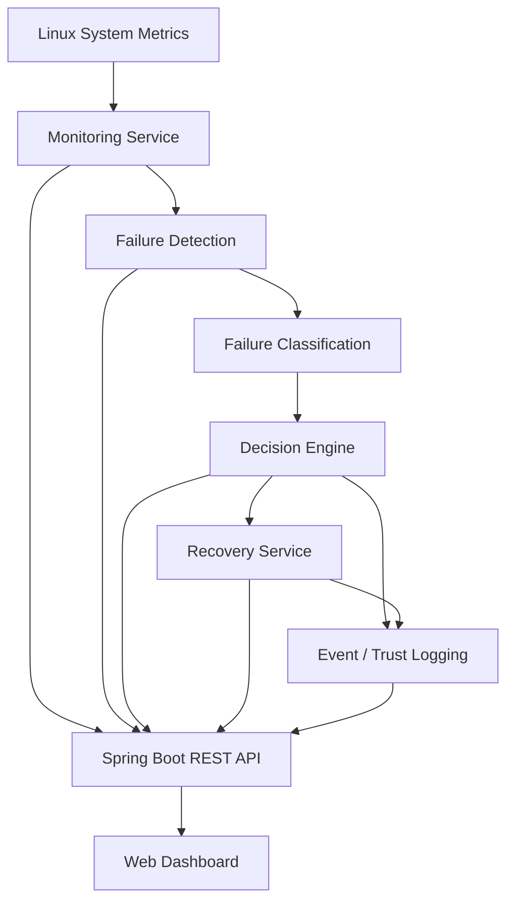

<div align="center">

# Decision-Driven Autonomous Self-Healing Cloud Infrastructure
### Blockchain-Based Trust and Recovery Management

<p>
  <strong>Monitor. Detect. Decide. Recover. Verify.</strong>
</p>

<p>
  A cloud-infrastructure prototype that monitors system health, identifies common resource failures, selects recovery actions, and records events for auditability.
</p>

<p>
  
  
  
  
  
</p>

<p>
  <a href="#-overview">Overview</a> •
  <a href="#-features">Features</a> •
  <a href="#-architecture">Architecture</a> •
  <a href="#-getting-started">Getting Started</a> •
  <a href="#-testing">Testing</a> •
  <a href="#-limitations-and-security">Security</a>
</p>

</div>

---

## Overview

**Decision-Driven Autonomous Self-Healing Cloud Infrastructure with Blockchain-Based Trust and Recovery Management** is a project that demonstrates how a system can respond to common infrastructure problems with less manual intervention.

It monitors CPU, RAM, and disk usage, detects abnormal conditions, classifies the issue, and chooses a recovery action. A web dashboard presents system health, decisions, events, and recovery information.

> **In simple terms:** when a monitored resource becomes unhealthy, the system attempts to identify the problem, choose a suitable response, and keep a record of what happened.

## Why this project?

Traditional monitoring can tell an administrator that something is wrong, but the administrator may still need to investigate and act. This prototype brings monitoring, rule-based decision-making, recovery actions, and event logging together in one workflow.

## Features

<table>
  <tr>
    <td width="50%">
      <h3>Live Resource Monitoring</h3>
      Displays CPU, RAM, and disk usage to help users understand system health.
    </td>
    <td width="50%">
      <h3>Failure Detection</h3>
      Uses configured resource thresholds and classification rules to identify potential overload conditions.
    </td>
  </tr>
  <tr>
    <td>
      <h3>Decision Engine</h3>
      Maps detected conditions to predefined recovery strategies.
    </td>
    <td>
      <h3>Automated Recovery</h3>
      Demonstrates recovery actions for supported CPU, memory, and disk scenarios.
    </td>
  </tr>
  <tr>
    <td>
      <h3>Integrity-Oriented Logging</h3>
      Includes blockchain-inspired logging / hash-chain concepts for recording events. Verify the implementation in the backend before treating logs as cryptographically tamper-evident.
    </td>
    <td>
      <h3>Interactive Dashboard</h3>
      Presents resource graphs, status, decisions, processes, incident history, recovery logs, and trust-related information.
    </td>
  </tr>
</table>

## Architecture



### Workflow

1. **Monitor** — collect system resource metrics.
2. **Detect** — check for conditions that cross configured thresholds.
3. **Classify** — identify the likely category, such as CPU overload, memory overload, or disk pressure.
4. **Decide** — select a predefined response using project rules.
5. **Recover** — execute the configured recovery action, where supported.
6. **Record and display** — expose system information and event logs through the dashboard.

## Technology Stack

| Layer | Technology |
|---|---|
| Backend | Java, Spring Boot |
| Build tool | Maven |
| Runtime environment | Linux / Ubuntu |
| Frontend | HTML, CSS, JavaScript |
| Charts | Chart.js |
| API style | REST endpoints |
| Integrity concept | Blockchain-inspired event / hash-chain logging |

*The exact technologies and versions should match the code currently committed to this repository.*

## Getting Started

### Prerequisites

- Linux or Ubuntu environment for system-monitoring and recovery features
- Java 21 (or the version configured in the project)
- Maven
- Git

### 1. Clone the repository

Replace `YOUR-USERNAME` and `YOUR-REPOSITORY` with your GitHub details.

```bash
git clone https://github.com/YOUR-USERNAME/YOUR-REPOSITORY.git
cd YOUR-REPOSITORY
```

### 2. Build the project

```bash
mvn clean package
```

### 3. Run the application

For a standard Spring Boot Maven project:

```bash
mvn spring-boot:run
```

Or, if the executable JAR was created successfully:

```bash
java -jar target/*.jar
```

### 4. Open the dashboard

Open the local address configured by the application, commonly:

```text
http://localhost:8080
```

If your application uses a different port, check `src/main/resources/application.properties` or `application.yml`.

## Dashboard

The dashboard is designed to bring key information into one place:

- CPU, RAM, and disk usage
- Resource history chart
- System status and health indicators
- Decision-engine output
- Neural Insight Engine (rule-based analysis, not a trained neural network unless a model has been added)
- Top processes
- Incident timeline
- Recovery logs
- Blockchain-related logs and trust information

**Screenshots:** Add your actual dashboard screenshot to the repository, for example at `docs/images/dashboard.png`, then uncomment and update this image:

<!--
<p align="center">
  
</p>
-->

## Testing

Test only in a **disposable local VM or test environment**. Resource stress tests can slow down or destabilize a machine.

| Scenario | Example test | Expected observation |
|---|---|---|
| CPU load | `yes > /dev/null &` | CPU usage rises; the detector may report CPU overload if its configured rule is met. |
| Memory pressure | Use a small, controlled memory test in a disposable VM. | Memory usage rises; detection depends on configured thresholds and sampling. |
| Disk pressure | Create a small test file inside a project-owned test directory. | Disk usage rises; detection depends on filesystem metrics and thresholds. |

Stop any test process you started when finished. Do not run aggressive memory or disk tests on your main machine or a server hosting other services.

## API Endpoints

The dashboard may use endpoints such as the following, depending on the current backend implementation:

| Endpoint | Purpose |
|---|---|
| `/api/system-health` | Current system-health data |
| `/api/logs` | Application event or recovery logs |
| `/api/processes` | Process information |

These paths are documented from the dashboard integration context and should be confirmed against the current controller classes. Additional endpoints may exist.

## Project Structure

A typical layout for this project is:

```text
YOUR-REPOSITORY/
├── pom.xml
├── src/
│   └── main/
│       ├── java/com/prathi/selfhealingcloud/
│       │   ├── classification/
│       │   ├── controller/
│       │   ├── scheduler/
│       │   └── service/
│       └── resources/
│           └── static/
│               ├── index.html
│               ├── style.css
│               └── app.js
├── README.md
└── .gitignore
```

The exact folders may differ as the project evolves.

## Limitations and Security

This is an **educational prototype**, not a production-ready cloud-management platform.

- Detection and decision-making are rule-based; the Neural Insight Engine should not be described as trained AI/ML unless a trained model is actually implemented.
- Blockchain-inspired logging is not the same as a distributed blockchain network. Describe it as cryptographic hash-chain logging only if the backend really computes and validates cryptographic hashes.
- Recovery actions can affect running processes and files. Broad process termination or deleting all files from `/tmp` is unsafe on shared or production machines.
- Do not expose recovery endpoints directly to the public internet. Add authentication, authorization, input validation, audit logging, and strict allow-lists before any remote-control deployment.
- Test with dedicated demo processes and a project-owned temporary directory. Never use this prototype to manage critical workloads without a proper safety review.

## Future Improvements

- Predict failures using a validated machine-learning model
- Add stronger recovery verification and rollback
- Implement verified SHA-256 hash-chain validation
- Add authentication and role-based access control
- Support container or Kubernetes monitoring
- Add automated tests, metrics, and deployment documentation

## Contributing

Suggestions and improvements are welcome. For substantial changes, open an issue first to discuss the proposed feature. Keep changes focused, document new configuration options, and test recovery behavior in a safe environment.

## License

No license is specified by this README. If you want others to reuse, modify, or distribute the code, add a license file such as `LICENSE` and update this section to match the license you choose.

## Author

**Developed as a final-year project** to explore autonomous infrastructure monitoring, rule-based self-healing, and integrity-oriented recovery logging.

---

<div align="center">

**Monitor • Detect • Decide • Recover • Record**

<sub>Built for learning, experimentation, and further development.</sub>

</div>
